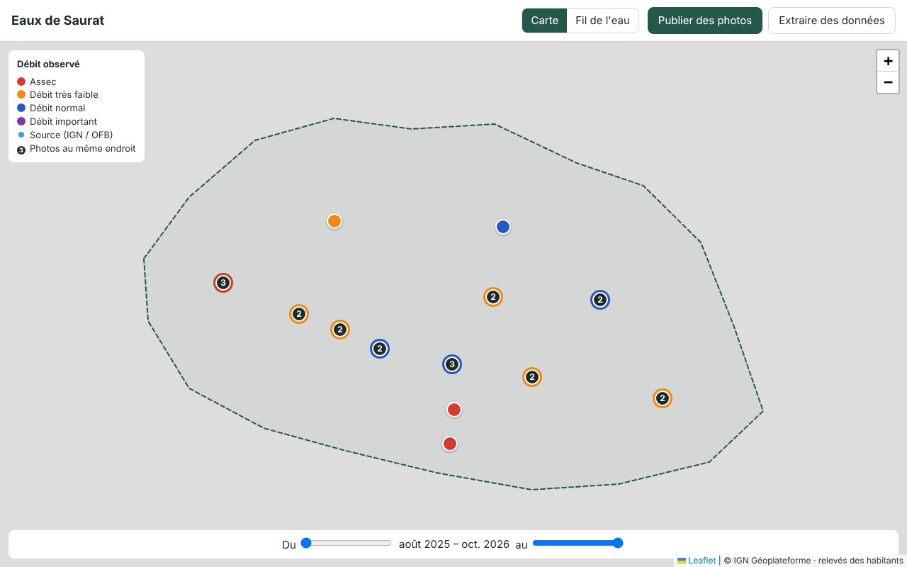
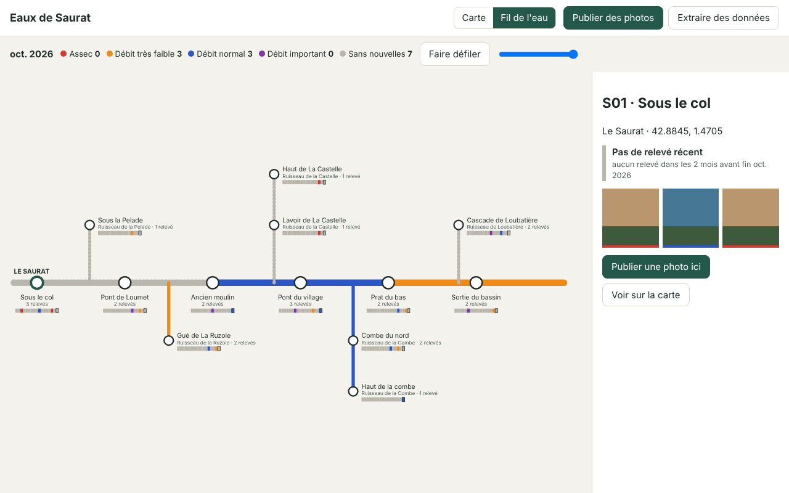

# Eaux de Saurat

A cooperative website where people living in the Saurat catchment (Ariège, France) publish geotagged photos of its rivers and brooks with the flow they observe, so everyone can follow how the water evolves.

Two views share the same readings:

- **Carte** (map): every photo on a map of the catchment, coloured by flow, grouped when less than 50 m apart, filtered by a time bar.
- **Fil de l'eau** (river plan): a schematic, metro-style plan of the river and its tributaries, each station coloured by its latest reading for the chosen month.

| Map | River plan |
| --- | --- |
|  |  |

The screenshots use the mockup's fictitious data; map tiles are not shown.

## Stack

| Part | Technology |
| --- | --- |
| Frontend | TypeScript + Vite, no framework, Leaflet, exifr |
| Backend | Python, Django 5 + GeoDjango, Django Ninja (JSON API) |
| Database | PostgreSQL 16 + PostGIS 3 |
| Serving | Caddy (HTTPS, frontend, photos), Docker Compose |

See [docs/architecture.md](docs/architecture.md) for how the parts fit together and why.

## Repository layout

```
backend/    Django project
  eds/        settings, URLs, API root
  readings/   Station and Reading models, API, attachment to stations, CSV export, admin
  geo/        Basin, Watercourse, Spring models and the IGN / OFB import command
frontend/   Vite app
  src/domain/   rules shared by both views (flow levels, 50 m grouping, station state, river plan layout)
  src/views/    map/ and river/
  src/publish/  EXIF reading, compression, publish form
  src/export/   CSV export form
data/       reference geodata (see data/README.md)
ops/        Caddy image, backup script, restore procedure
```

## Running locally

Non-technical testers: open `tester-le-site/GUIDE.html` (French, Docker Desktop and double-click scripts).

Requirements: Python 3.15, Node 26, PostgreSQL 18 with PostGIS 3.6, GDAL.

```sh
# Database (once)
createuser -s eaux && createdb -O eaux eaux   # password "eaux", or set POSTGRES_* variables

# Backend
cd backend
python -m venv .venv && . .venv/bin/activate
pip install -r requirements-dev.txt
export DJANGO_DEBUG=true             # development only: the built-in secret key is refused otherwise
python manage.py migrate
python manage.py seed_demo          # real geodata from data/, fictitious readings
python manage.py createsuperuser    # for /admin
python manage.py runserver

# Frontend, in another terminal
cd frontend
npm install
npm run dev                         # http://localhost:5173, proxies /api to Django
```

Tests: `pytest` in `backend/`, `npm test` in `frontend/`.

## Deploying

On a small VPS with Docker:

```sh
cp .env.example .env    # set SITE_ADDRESS, secrets and passwords: Django refuses to start with DJANGO_SECRET_KEY=change-me
                        # and add the association's IP to ADMIN_ALLOWED_IPS, or /admin answers 403 from the internet
docker compose up -d --build
docker compose exec backend python manage.py createsuperuser
docker compose exec backend python /data/download_tiles.py   # map tiles, once (85 MB); later runs skip them
```

Upgrading from the PostgreSQL 16 stack: the database volume layout changed with PostgreSQL 18, so an old `pgdata` volume will not start. Development data can simply be recreated with `docker compose down -v`, then `up -d --build` and `seed_demo`. Real data must be dumped with `ops/backup.sh` before the upgrade and restored with `ops/restore.md` after it.

Caddy obtains the HTTPS certificate for `SITE_ADDRESS` automatically. Set up `ops/backup.sh` as a nightly cron job and test `ops/restore.md` once per quarter.

## Licence

Code: MIT (see [LICENSE](LICENSE)). The licence for published photos and readings is still to be decided.
